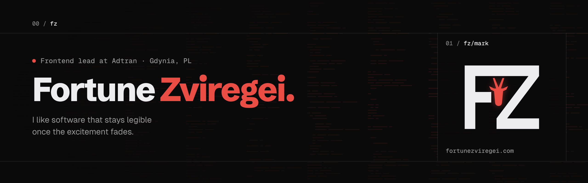

<a href="https://fortunezviregei.com">
  <picture>
    <source media="(prefers-color-scheme: dark)" srcset="assets/header-night.png">
    <source media="(prefers-color-scheme: light)" srcset="assets/header-day.png">
    
  </picture>
</a>

`01 / fz/intro`

I ship full-stack web work: frontends people enjoy using, backends that behave under load, and the habits in between that keep releases calm. Give me ambiguity, brittle pages, or a patchwork stack and I will tighten it until the next increment feels ordinary.

`02 / fz/experience`

| Role | Company | When | Where |
|---|---|---|---|
| Software Engineer (Frontend Lead) | Adtran | Oct 2025 to present | Gdynia, PL |
| Software Developer | Treehouse | Apr 2022 to May 2025 | Gdańsk, PL |
| Frontend Developer | Xenon Partners | Sep 2021 to Mar 2022 | Gdańsk, PL |
| Freelance Software Developer | Zapeture Creations | Feb 2019 to Aug 2021 | Bydgoszcz, PL |

`03 / fz/writing`

- [How to add a dynamic favicon in Next.js (based on user theme)](https://medium.com/@fortunechainz/how-to-add-a-dynamic-favicon-in-next-js-based-on-user-theme-32a05e85a937) · Jun 2025
- [Introduction to software design patterns](https://medium.com/@fortunechainz/introduction-to-software-design-patterns-664cb0846b68) · Jun 2025

`04 / fz/contact`

You can reach me by [email](mailto:fortunechainz@gmail.com).

[`FORTUNEZVIREGEI.COM ↗`](https://fortunezviregei.com) &nbsp; [`LINKEDIN ↗`](https://www.linkedin.com/in/fortune-zviregei-029161163/) &nbsp; [`MEDIUM ↗`](https://medium.com/@fortunechainz) &nbsp; [`X ↗`](https://x.com/code_fortune) &nbsp; [`INSTAGRAM ↗`](https://www.instagram.com/code_fortune)
